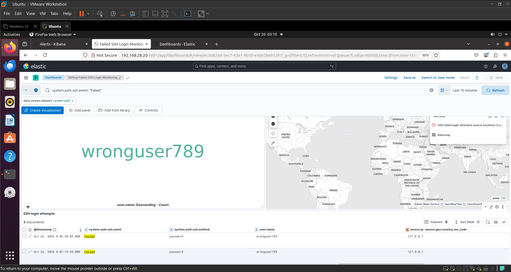
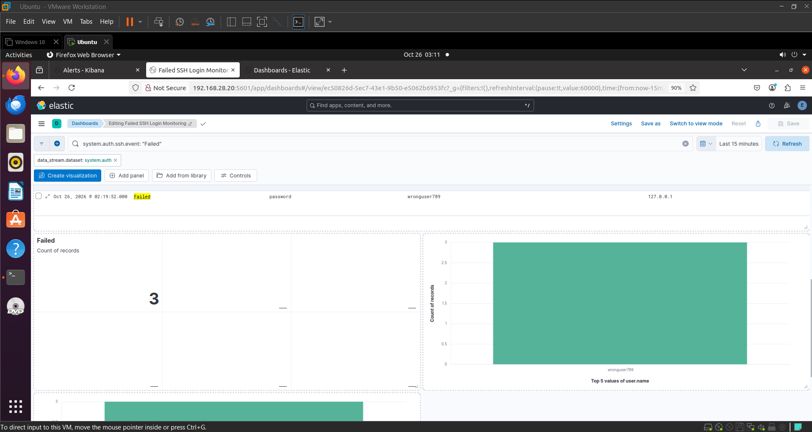
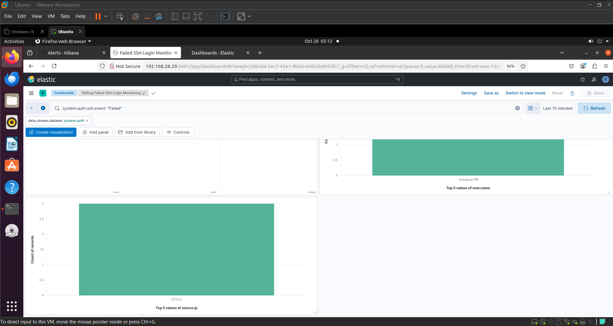

# Linux Security Monitoring

## About
This is a small project I worked on to learn more about Linux security and log monitoring.

I used Ubuntu and the Elastic Stack to collect system logs and monitor failed SSH login attempts. I also created a dashboard in Kibana to view the results.

## Tools
- Ubuntu Linux
- Elasticsearch
- Kibana
- Elastic Agent
- SSH

## What I Did
- Set up Elasticsearch and Kibana.
- Configured Elastic Agent to collect system logs.
- Checked SSH login attempts in Kibana.
- Created a dashboard to show failed login attempts.
- Added charts to view usernames and source IP addresses.

## Testing
I tested the setup by trying to log in using a username that does not exist.

The login was rejected, and the failed attempts appeared in Kibana.

Test username: `wronguser789`

Source IP: `127.0.0.1`

## What I Learned
This project helped me practice working with Linux, understand authentication logs, and learn how to use Kibana to monitor security events.

## Dashboard Screenshots

### Screenshot 1

### Screenshot 2

### Screenshot 3

### Screenshot 4

## Results

- Successfully configured Elasticsearch and Kibana for Linux security monitoring.
- Collected Ubuntu system logs using Elastic Agent.
- Generated failed SSH login events during testing.
- Verified that failed login events appeared in Kibana.
- Created a Kibana dashboard to visualize failed login attempts by username and source IP address.

## Conclusion

This project provided hands-on experience with Linux log monitoring, Elasticsearch, Kibana, and basic security event analysis. It helped me understand how SIEM tools can be used to monitor authentication activity and investigate suspicious login attempts.
